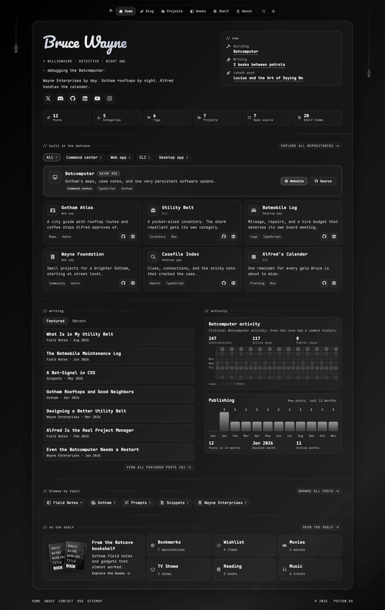
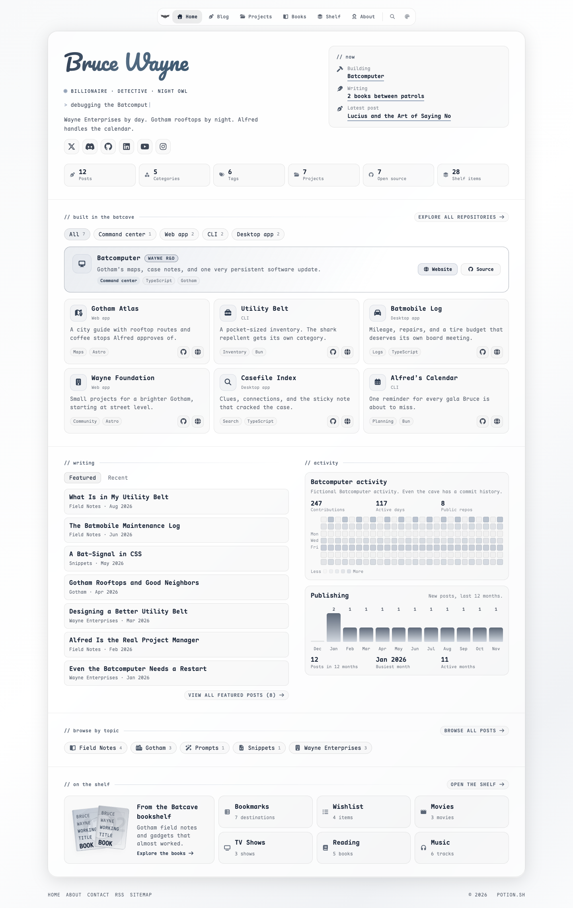
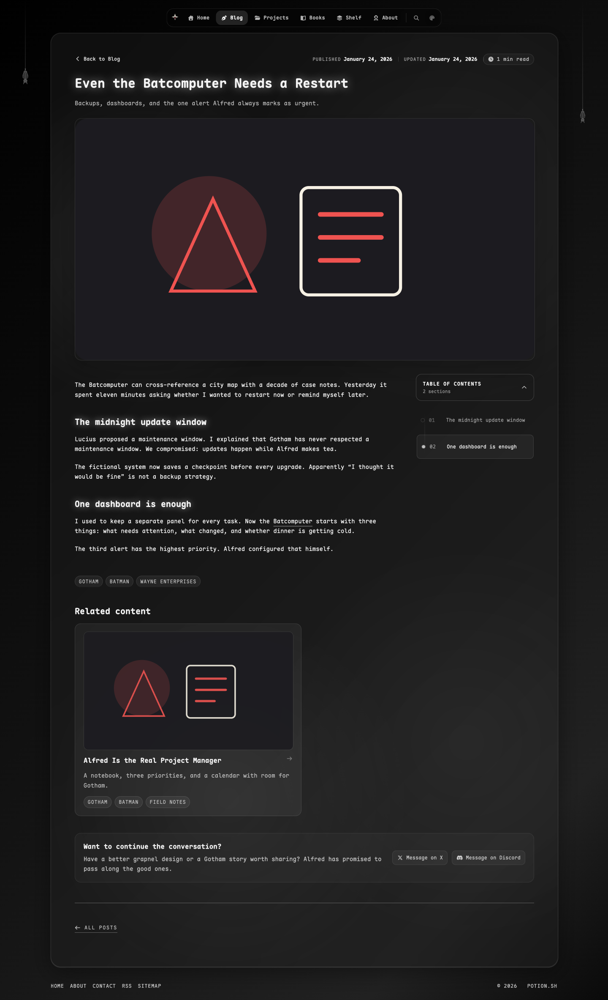

# <picture><source media="(prefers-color-scheme: dark)" srcset="apps/web/public/batcave-logo-dark.svg"></picture> Batcave

An Astro portfolio and blog template with a card-based layout, eight themes, and a playful look inside Bruce Wayne's double life.



<details>
<summary>See light mode and the reading experience</summary>

### Light mode



### Inside an article



</details>

## Features

- **Astro 7, React 19, and TypeScript:** a static site you can host anywhere, with small interactive islands.
- **A portfolio homepage:** your profile, social links, current projects, writing, activity, topics, and shelf in one card deck.
- **Eight themes:** four dark and four light variants, including Parchment. Dark is the default; the picker remembers each visitor's choice.
- **Hanging bats:** dark themes include two bats in the desktop margins, with hover wings and occasional flaps that respect reduced motion.
- **Shared typography:** self-hosted Maple Mono for text and Pacifico for the homepage name.
- **Twelve sample posts:** fictional Gotham stories demonstrate articles, snippets, copyable prompts, and detailed and compact lists.
- **Organized writing:** featured and recent tabs, categories, tags, pagination, reading time, related posts, and a collapsible table of contents.
- **Site search:** find posts, projects, books, bookmarks, wishlist entries, ratings, and About content.
- **Project showcases:** a spotlight, filterable homepage tiles, project detail pages, and paired light/dark artwork.
- **A personal shelf:** books, bookmarks, wishlist, movies, TV shows, reading, and music playlists.
- **Activity at a glance:** fictional contributions by default, optional live GitHub data, and a publishing chart derived from your posts.
- **Publishing controls:** private drafts stay outside the article collection; draft projects stay out of public listings, search, and the sitemap.
- **SEO and feeds:** canonical URLs, social metadata, structured data, RSS, and a sitemap.
- **Development checks:** Biome, Astro/TypeScript checks, Bun tests, source validation, and rendered accessibility and link checks.

The demo follows Wayne Enterprises by day and Batman after dark. Its posts, gadgets, books, reviews, and playlists are fictional sample content for an unofficial template. Social links open platform homepages; fictional product links use reserved `example.org` destinations.

## Get started

Use **Node.js 24** and **Bun 1.4.4**. From the repository root:

```sh
bun install --frozen-lockfile
bun run dev
```

Open the local URL printed in your terminal, usually `http://localhost:4321`. Use Bun for package management so the shared lockfile stays consistent. Restart the dev server after dependency or lockfile changes.

Astro prevents two dev servers from running for the same project by default. To stop an existing server, run `bun run --cwd apps/web dev stop`. To intentionally run a second copy on the next available port, run `bun run dev --ignore-lock`.

## mise

If you use [mise](https://mise.jdx.dev/), run `mise install` once from the repository root, then `mise run <task>`. Mise selects the pinned Bun runtime; Node 24 must also be available on your machine.

| Task | What it runs |
| --- | --- |
| `install` | `bun install --frozen-lockfile` |
| `dev` | `bun run dev` |
| `build` | `bun run build` |
| `preview` | `bun run preview` |
| `quality` | `bun run quality` |
| `format` | `bun run format` |
| `format:check` | `bun run format:check` |
| `lint` | `bun run lint` |
| `lint:fix` | `bun run lint:fix` |
| `check` | `bun run check` |
| `test` | `bun run test` |
| `validate:source` | `bun run validate:source` |
| `validate` | `bun run validate` |
| `artwork:projects` | `bun run artwork:projects` |

Extra arguments are forwarded, for example `mise run dev --host 127.0.0.1`. Run `mise tasks` to see the available tasks.

## Make it yours

The site lives in `apps/web/`. Start with these files:

| Change | File or directory |
| --- | --- |
| Site name, domain, author, social links, and footer credit | [`constants.ts`](apps/web/src/lib/constants.ts) |
| Display limits, draft visibility, activity, and analytics | [`config.ts`](apps/web/src/lib/config.ts) |
| About story, interests, and tools | [`about.ts`](apps/web/src/lib/about.ts) |
| Articles, snippets, prompts, and lists | [`content/articles/`](apps/web/src/content/articles/) |
| Private draft starter | [`sample-draft.md`](apps/web/src/content/drafts/sample-draft.md) |
| Projects and their detail pages | [`projects.ts`](apps/web/src/lib/projects.ts) |
| Homepage repository showcase | [`openSource.ts`](apps/web/src/lib/openSource.ts) |
| Author book projects | [`books.ts`](apps/web/src/lib/books.ts) |
| Contact profiles | [`contact.ts`](apps/web/src/lib/contact.ts) |
| Bookmarks and wishlist | [`directory.ts`](apps/web/src/lib/directory.ts), [`wishlist.ts`](apps/web/src/lib/wishlist.ts) |
| Movies, TV shows, and reading | [`movies.ts`](apps/web/src/lib/movies.ts), [`tvShows.ts`](apps/web/src/lib/tvShows.ts), [`reading.ts`](apps/web/src/lib/reading.ts) |
| Music playlists | [`music.ts`](apps/web/src/lib/music.ts) |
| Theme colors and the default theme | [`themes.ts`](apps/web/src/lib/themes.ts) |
| Fonts and shared type sizes | [`typography.css`](apps/web/src/styles/typography.css) |
| Bat sizes, hanging heights, and flap timing | [`bats.ts`](apps/web/src/lib/bats.ts) |
| Logos and article/project artwork | [`public/`](apps/web/public/) |

Set `SITE_HOST` in `constants.ts` to your own domain before deploying. Astro uses the derived `SITE_URL` too. `example.com` is a placeholder for canonical URLs. The footer's `FOOTER_CREDIT` is configured separately.

Replace the fictional catalogs, author details, sample posts, logo, favicon, and artwork. Update article `author` and `canonicalUrl` frontmatter, including the private draft starter. Run `bun run artwork:projects` to regenerate project SVGs from your catalog; its labels and motifs are demo artwork too.

To write a post, copy a sample Markdown file and update its frontmatter. [Even the Batcomputer Needs a Restart](apps/web/src/content/articles/2026/the-batcomputer-needs-a-restart.md) demonstrates a regular article. Keep unfinished work in `content/drafts/`, then move it into the appropriate `content/articles/YYYY/` folder when ready to publish. The year folder is independent of the post's category.

Music ships with fictional Gotham playlists and local artwork. Tracks without a `youtubeId` open the YouTube homepage. Add valid video IDs in `music.ts` to enable individual watch links and thumbnails; the site does not load music embeds.

### Activity and analytics

GitHub activity uses deterministic fictional data without external requests by default. To show live activity, set `GITHUB_ACTIVITY_USERNAME` in `config.ts` and update `GITHUB_PROFILE_URL` in `constants.ts`. Live mode calls GitHub's public API and the contributions API configured in [`github.ts`](apps/web/src/lib/github.ts).

Vercel Web Analytics is off by default. Set `ENABLE_ANALYTICS` in `config.ts` if you want to enable it for your deployment.

## Build and deploy

From the repository root:

```sh
bun run build
bun run preview
```

Deploy **`apps/web/dist/`** to your static host. Use `bun install --frozen-lockfile` as the install command. The root build command is `bun run build`; when the host's root directory is `apps/web`, its `bun run build` runs Astro directly.

For Vercel, configure your own project with Root Directory **`apps/web`** and Node 24. [`apps/web/vercel.json`](apps/web/vercel.json) disables native Git deployments. Adjust it if you prefer Vercel's automatic deployments.

The optional [production workflow](.github/workflows/vercel-production.yml) deploys stable GitHub releases or runs manually through `workflow_dispatch`. Configure your own Production environment and `VERCEL_TOKEN`, `VERCEL_ORG_ID`, and `VERCEL_PROJECT_ID` secrets before using it. Ordinary pushes do not trigger that workflow. No deployment project or custom site domain is bundled with the template.

To bind another local network interface, copy [`apps/web/.env.example`](apps/web/.env.example) to `apps/web/.env` and set `DEV_HOST`. Keep machine addresses out of Git. With no `DEV_HOST`, Astro stays on localhost.

## Development checks

```sh
bun run quality
```

This runs formatting, lint, source validation, Astro/TypeScript checks, all Bun tests, the production build, and rendered accessibility and internal link validation. Individual checks are also available:

```sh
bun run format:check
bun run lint
bun run validate:source
bun run check
bun run test
bun run build
bun run validate
```

Template tests in [`tests/template.test.ts`](tests/template.test.ts) protect sample metadata, platform homepage links, fictional activity, and filled homepage sections. Adapt these assertions when you replace the demo with your own content. The project does not include a Playwright test suite.

Dependencies use exact versions. [`bunfig.toml`](bunfig.toml) requires new package resolutions to be at least two days old. [`AGENTS.md`](AGENTS.md) contains the repository architecture and contribution rules.

Contributions are welcome. Run the checks above before opening a pull request.

## Credits

Made with ♥ by [potion.sh](https://potion.sh).
